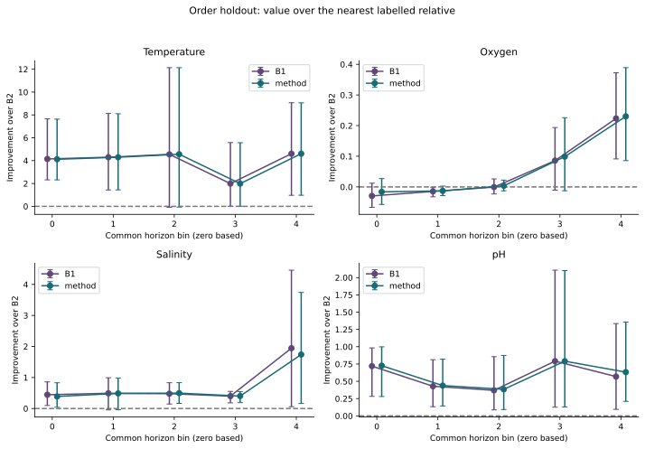

# Growth Horizon: methods and empirical evaluation

GeneX Labs Inc. | Research prototype on this labelled GTDB-mapped table; not tested on prospective cultures, on organisms outside the table, or for clinical or production use.

## Question and evidence

Growth predictions can carry different information for a close relative and a distant organism. This study evaluates that distinction using the full usable growth-labelled population, the published GenomeSPOT feature table and the current GTDB reference taxonomy. It measures error, interval or set coverage, uncertainty size and abstention without presenting any laboratory result. The labels are accepted as table-level experimental records, rather than independently authenticated measurements for every value.

The locked targets fail for calibration and accuracy. A useful empirical coverage level does not itself establish a guarantee or a pass: the calibration target jointly requires each supported cell, the pooled coverage and the naive far-bin comparison. This joint criterion matters when interpreting the results.

The two earlier v2-era freezes were 839b22f (2026-10-11 05:54:49 PT, amendment C and v2) and 3b1f6d2 (2026-10-11 07:04:00 PT, re-freeze after normalising calibration artefacts); both preceded any outer-fold number. [data/gtdb-derived/results/public-results.tsv:L620](../data/gtdb-derived/results/public-results.tsv)

## Frozen analysis

Five grouped outer folds at genus, family, order, class and phylum keep each taxon together. A random split is an optimistic reference, with species as the bootstrap cluster. Every eligible labelled assembly is included for its trait; missing labels and release-mapping exclusions are counted separately. Current usable populations contain temperature, oxygen, salinity and pH records as documented in the pinned population table. [data/gtdb-derived/results/public-results.tsv:L619](../data/gtdb-derived/results/public-results.tsv)

Distances are sums of GTDB branch lengths to the nearest training representative, with bacterial and archaeal domains separate. Nonrepresentatives map to the representative leaf. Equal distances are not split artificially. Ties choose the smallest training representative and then accession. Missing-domain sources have infinite distance and cause abstention.

Five inner calibration fits score their held-out training taxa. Calibration-bin cuts pool phenotype-free tuning-holdout distances, and adjacent bins merge by distinct-taxon union until the fixed support floor is reached. The common horizon cuts pool the corresponding distances over outer folds. No outer phenotype selects an estimator, bin or threshold. [data/gtdb-derived/results/public-results.tsv:L618](../data/gtdb-derived/results/public-results.tsv)

## Predictors

B0 is the outer training mean or oxygen majority class. B1 retrains the GenomeSPOT estimator specification. B2 copies the nearest labelled relative from the frozen point-fit training rows. B3 uses whole-proteome amino-acid frequencies with ridge or balanced logistic regression. The proposed predictor selects B1 or a regularised compartment-frequency alternative solely by proper-side grouped tuning. Original point fits determine all primary errors and horizons. B4 is excluded for the documented licence and annotation-input limitations.

<!-- page -->

# Interval scoring and locked results

Numeric intervals use CV+ order statistics across the calibration rows of the selected distance bin, preserving each scoring fit's prediction at the query. Oxygen is a class label with uncertainty represented by a prediction set. It uses randomized inverse-quantile scores and the paper's strict comparison rule with one shared query randomisation across all fits and methods. The naive comparator retains its separately fitted random-inner calibration spread.

An abstained item counts as covered exactly when its computed interval or set contains the true value; abstention rates are reported beside every coverage figure. Unsupported bins are excluded from every coverage figure. Empty oxygen prediction sets are misses. Numeric intervals may cover while exceeding the usefulness limit. No accepted-item coverage guarantee is asserted.

Coverage is nominally at the protocol level, with fixed numeric width limits and the fixed calibration-taxon support rule. Error and coverage intervals use paired held-out-taxon bootstrap draws, retaining every genome whenever its taxon is drawn. Single-taxon cells have no uncertainty estimate. [data/gtdb-derived/results/public-results.tsv:L618](../data/gtdb-derived/results/public-results.tsv)

## Order-holdout accuracy

| Trait | B1 error [95% interval] | Proposed error [95% interval] | Paired reduction [95% interval] | Pinned source line |
| --- | --- | --- | --- | --- |
| Temperature | 4.4857 [4.0306, 4.9648] | 4.4886 [4.0228, 4.9747] | -0.0029 [-0.0251, 0.0177] | [data/gtdb-derived/results/public-results.tsv:L56](../data/gtdb-derived/results/public-results.tsv); [data/gtdb-derived/results/public-results.tsv:L69](../data/gtdb-derived/results/public-results.tsv); [data/gtdb-derived/results/public-results.tsv:L76](../data/gtdb-derived/results/public-results.tsv) |
| Oxygen | 0.1415 [0.0904, 0.2003] | 0.1307 [0.0794, 0.1936] | 0.0108 [-0.0054, 0.0283] | [data/gtdb-derived/results/public-results.tsv:L206](../data/gtdb-derived/results/public-results.tsv); [data/gtdb-derived/results/public-results.tsv:L219](../data/gtdb-derived/results/public-results.tsv); [data/gtdb-derived/results/public-results.tsv:L226](../data/gtdb-derived/results/public-results.tsv) |
| Salinity | 1.6909 [1.3177, 2.2457] | 1.7306 [1.3117, 2.4045] | -0.0397 [-0.1677, 0.0247] | [data/gtdb-derived/results/public-results.tsv:L356](../data/gtdb-derived/results/public-results.tsv); [data/gtdb-derived/results/public-results.tsv:L369](../data/gtdb-derived/results/public-results.tsv); [data/gtdb-derived/results/public-results.tsv:L376](../data/gtdb-derived/results/public-results.tsv) |
| pH | 0.5250 [0.4789, 0.5832] | 0.5093 [0.4697, 0.5570] | 0.0157 [0.0006, 0.0407] | [data/gtdb-derived/results/public-results.tsv:L506](../data/gtdb-derived/results/public-results.tsv); [data/gtdb-derived/results/public-results.tsv:L519](../data/gtdb-derived/results/public-results.tsv); [data/gtdb-derived/results/public-results.tsv:L526](../data/gtdb-derived/results/public-results.tsv) |

Numeric error is mean absolute error. Oxygen error is one minus balanced accuracy. The paired column is B1 error minus proposed error; positive values favour the proposal. Pinned sources: temperature_optimum: [data/gtdb-derived/results/public-results.tsv:L56](../data/gtdb-derived/results/public-results.tsv); [data/gtdb-derived/results/public-results.tsv:L69](../data/gtdb-derived/results/public-results.tsv); [data/gtdb-derived/results/public-results.tsv:L76](../data/gtdb-derived/results/public-results.tsv). oxygen: [data/gtdb-derived/results/public-results.tsv:L206](../data/gtdb-derived/results/public-results.tsv); [data/gtdb-derived/results/public-results.tsv:L219](../data/gtdb-derived/results/public-results.tsv); [data/gtdb-derived/results/public-results.tsv:L226](../data/gtdb-derived/results/public-results.tsv). salinity_optimum: [data/gtdb-derived/results/public-results.tsv:L356](../data/gtdb-derived/results/public-results.tsv); [data/gtdb-derived/results/public-results.tsv:L369](../data/gtdb-derived/results/public-results.tsv); [data/gtdb-derived/results/public-results.tsv:L376](../data/gtdb-derived/results/public-results.tsv). ph_optimum: [data/gtdb-derived/results/public-results.tsv:L506](../data/gtdb-derived/results/public-results.tsv); [data/gtdb-derived/results/public-results.tsv:L519](../data/gtdb-derived/results/public-results.tsv); [data/gtdb-derived/results/public-results.tsv:L526](../data/gtdb-derived/results/public-results.tsv).

## Family and order coverage

| Trait / rank | Pooled coverage [95% interval] | Accepted coverage [95% interval] | Abstention | Mean width or cardinality | Accepted mean width or cardinality | Pinned source line |
| --- | --- | --- | --- | --- | --- | --- |
| Temperature / family | 90.07% [88.05%, 91.94%] | 89.99% [88.01%, 91.86%] | 8.06% | 17.8647 | 17.5959 | [data/gtdb-derived/results/public-results.tsv:L44](../data/gtdb-derived/results/public-results.tsv) |
| Temperature / order | 90.29% [87.99%, 92.25%] | 90.17% [87.61%, 92.38%] | 20.38% | 18.7015 | 17.5541 | [data/gtdb-derived/results/public-results.tsv:L69](../data/gtdb-derived/results/public-results.tsv) |
| Oxygen / family | 90.89% [89.20%, 92.39%] | 95.41% [93.45%, 97.02%] | 22.53% | 1.1141 | 1.0000 | [data/gtdb-derived/results/public-results.tsv:L194](../data/gtdb-derived/results/public-results.tsv) |
| Oxygen / order | 92.10% [89.46%, 94.37%] | 94.61% [91.64%, 97.16%] | 25.56% | 1.1779 | 1.0000 | [data/gtdb-derived/results/public-results.tsv:L219](../data/gtdb-derived/results/public-results.tsv) |
| Salinity / family | 90.63% [87.84%, 92.97%] | 90.32% [87.56%, 92.69%] | 6.69% | 6.8323 | 6.7127 | [data/gtdb-derived/results/public-results.tsv:L344](../data/gtdb-derived/results/public-results.tsv) |
| Salinity / order | 89.99% [82.28%, 94.97%] | 83.32% [71.31%, 91.84%] | 48.15% | 7.7806 | 6.7489 | [data/gtdb-derived/results/public-results.tsv:L369](../data/gtdb-derived/results/public-results.tsv) |
| pH / family | 90.35% [88.49%, 91.97%] | 90.37% [88.36%, 91.87%] | 0.06% | 2.2096 | 2.2090 | [data/gtdb-derived/results/public-results.tsv:L494](../data/gtdb-derived/results/public-results.tsv) |
| pH / order | 89.04% [86.64%, 91.07%] | 89.04% [86.64%, 91.07%] | 0.00% | 2.1944 | 2.1944 | [data/gtdb-derived/results/public-results.tsv:L519](../data/gtdb-derived/results/public-results.tsv) |

Pinned coverage sources: [data/gtdb-derived/results/public-results.tsv:L44](../data/gtdb-derived/results/public-results.tsv) [data/gtdb-derived/results/public-results.tsv:L69](../data/gtdb-derived/results/public-results.tsv) [data/gtdb-derived/results/public-results.tsv:L194](../data/gtdb-derived/results/public-results.tsv) [data/gtdb-derived/results/public-results.tsv:L219](../data/gtdb-derived/results/public-results.tsv) [data/gtdb-derived/results/public-results.tsv:L344](../data/gtdb-derived/results/public-results.tsv) [data/gtdb-derived/results/public-results.tsv:L369](../data/gtdb-derived/results/public-results.tsv) [data/gtdb-derived/results/public-results.tsv:L494](../data/gtdb-derived/results/public-results.tsv) [data/gtdb-derived/results/public-results.tsv:L519](../data/gtdb-derived/results/public-results.tsv)

Accepted-item coverage has no nominal guarantee. Accepted items exclude abstentions and unsupported rows.

Unsupported phylum calibration and the unsupported salinity class bins remain visible as abstentions in the complete results. Taxon-weighted coverage provides a separate view of unequal taxon size; it changes no primary target.

<!-- page -->

# Target interpretation and baseline limits

- Target 1: failed. [data/gtdb-derived/results/public-results.tsv:L602](../data/gtdb-derived/results/public-results.tsv)
- Target 2: failed. [data/gtdb-derived/results/public-results.tsv:L603](../data/gtdb-derived/results/public-results.tsv)
- Target 3 (publication): pending external publication; horizon estimates for every trait are complete in the package. [data/gtdb-derived/results/public-results.tsv:L604](../data/gtdb-derived/results/public-results.tsv)
- Target 4: passed. [data/gtdb-derived/results/public-results.tsv:L605](../data/gtdb-derived/results/public-results.tsv)

Target 1 failed on two of its three parts. Pooled coverage intervals reached 90% in all eight trait and rank cells. Two supported bins had intervals wholly below 87% (temperature/order fold 2 bin 0; salinity/family fold 3 bin 2). The naive far-bin condition held in 1 of 8 cells, temperature/order, for both B1 and B2. Elsewhere at least one naive comparator covered more than 80%, or had an upper limit of 90% or more, in the far bin. [data/gtdb-derived/results/public-results.tsv:L602](../data/gtdb-derived/results/public-results.tsv); [data/gtdb-derived/results/public-results.tsv:L618](../data/gtdb-derived/results/public-results.tsv)

The order-holdout accuracy target fails because the required relative error reduction with a positive paired interval is not reached on the required number of traits. Oxygen at phylum is a 12.9% reduction whose interval excludes zero, and oxygen on the random split is a 14.4% reduction whose interval excludes zero. Those splits are outside that target. [data/gtdb-derived/results/public-results.tsv:L603](../data/gtdb-derived/results/public-results.tsv)

Target 4 counts order rank only. B1 has lower point error than the proposed predictor for order-holdout temperature and salinity; neither paired interval excludes zero. [data/gtdb-derived/results/public-results.tsv:L605](../data/gtdb-derived/results/public-results.tsv); [data/gtdb-derived/results/public-results.tsv:L76](../data/gtdb-derived/results/public-results.tsv); [data/gtdb-derived/results/public-results.tsv:L376](../data/gtdb-derived/results/public-results.tsv) B1 also has lower point error for temperature at genus, phylum and the random split, salinity at family, class and phylum, and pH at phylum; none of those paired intervals excludes zero. Salinity at genus is identical. [data/gtdb-derived/results/public-results.tsv:L26](../data/gtdb-derived/results/public-results.tsv); [data/gtdb-derived/results/public-results.tsv:L126](../data/gtdb-derived/results/public-results.tsv); [data/gtdb-derived/results/public-results.tsv:L151](../data/gtdb-derived/results/public-results.tsv); [data/gtdb-derived/results/public-results.tsv:L351](../data/gtdb-derived/results/public-results.tsv); [data/gtdb-derived/results/public-results.tsv:L401](../data/gtdb-derived/results/public-results.tsv); [data/gtdb-derived/results/public-results.tsv:L426](../data/gtdb-derived/results/public-results.tsv); [data/gtdb-derived/results/public-results.tsv:L576](../data/gtdb-derived/results/public-results.tsv); [data/gtdb-derived/results/public-results.tsv:L326](../data/gtdb-derived/results/public-results.tsv)

The training-mean baseline B0 has the lowest point error for temperature at phylum and for pH at class and phylum, limiting the value of genome-based predictions at these ranks. [data/gtdb-derived/results/public-results.tsv:L102](../data/gtdb-derived/results/public-results.tsv); [data/gtdb-derived/results/public-results.tsv:L106](../data/gtdb-derived/results/public-results.tsv); [data/gtdb-derived/results/public-results.tsv:L111](../data/gtdb-derived/results/public-results.tsv); [data/gtdb-derived/results/public-results.tsv:L115](../data/gtdb-derived/results/public-results.tsv); [data/gtdb-derived/results/public-results.tsv:L119](../data/gtdb-derived/results/public-results.tsv); [data/gtdb-derived/results/public-results.tsv:L527](../data/gtdb-derived/results/public-results.tsv); [data/gtdb-derived/results/public-results.tsv:L531](../data/gtdb-derived/results/public-results.tsv); [data/gtdb-derived/results/public-results.tsv:L536](../data/gtdb-derived/results/public-results.tsv); [data/gtdb-derived/results/public-results.tsv:L540](../data/gtdb-derived/results/public-results.tsv); [data/gtdb-derived/results/public-results.tsv:L544](../data/gtdb-derived/results/public-results.tsv); [data/gtdb-derived/results/public-results.tsv:L552](../data/gtdb-derived/results/public-results.tsv); [data/gtdb-derived/results/public-results.tsv:L556](../data/gtdb-derived/results/public-results.tsv); [data/gtdb-derived/results/public-results.tsv:L561](../data/gtdb-derived/results/public-results.tsv); [data/gtdb-derived/results/public-results.tsv:L565](../data/gtdb-derived/results/public-results.tsv); [data/gtdb-derived/results/public-results.tsv:L569](../data/gtdb-derived/results/public-results.tsv)

## Literature finding

In our literature check of 2026-10-11, we did not find a report of calibrated prediction intervals for genome-based prediction of microbial growth conditions that gives coverage separately for bins of phylogenetic distance to the training set, under whole-family or whole-order hold-out. The closest work we found reports interval coverage across phylogenetic-distance cutoffs for a different microbial trait, 16S rRNA gene copy number (Gao and Wu, 2023), and false discovery control within sequence-identity groups for enzyme function prediction (Ding, Luo and Luo, 2024). This is a bounded search finding, not a claim that no such work exists.

<!-- page -->

# Order-holdout horizons and secondary checks

The table in this section is the order rank only. Per-rank records are the JSON files under data/gtdb-derived/results/. At class, temperature already fails in the nearest bin for both predictors. At phylum, the horizons are unidentified. The B1 ordinal interval is shown beside the proposed interval because the two intervals are not the same for every trait. The horizon rule compares with B0, using the frozen common distance cuts. It is the first bin where the lower confidence limit for the improvement reaches zero or most items abstain. For oxygen, improvement is balanced accuracy minus chance. Value over B2 is reported in every bin without imposing a first-failure rule. Empty or unsupported horizon bins produce an unidentified state.

| Trait | Proposed horizon | B1 horizon | Proposed ordinal interval | B1 ordinal interval | Pinned source line |
| --- | --- | --- | --- | --- | --- |
| Temperature | Bin 1 (0.3736 to 0.4558) | Bin 1 (0.3736 to 0.4558) | [1, 4] | [1, 4] | [data/gtdb-derived/results/public-results.tsv:L75](../data/gtdb-derived/results/public-results.tsv); [data/gtdb-derived/results/public-results.tsv:L74](../data/gtdb-derived/results/public-results.tsv) |
| Oxygen | Beyond observed range | Beyond observed range | [5, 5] | [0, 5] | [data/gtdb-derived/results/public-results.tsv:L225](../data/gtdb-derived/results/public-results.tsv); [data/gtdb-derived/results/public-results.tsv:L224](../data/gtdb-derived/results/public-results.tsv) |
| Salinity | Bin 2 (0.4492 to 0.5172) | Bin 2 (0.4492 to 0.5172) | [1, 3] | [1, 5] | [data/gtdb-derived/results/public-results.tsv:L375](../data/gtdb-derived/results/public-results.tsv); [data/gtdb-derived/results/public-results.tsv:L374](../data/gtdb-derived/results/public-results.tsv) |
| pH | Bin 2 (0.4577 to 0.5206) | Bin 1 (0.3674 to 0.4577) | [2, 5] | [1, 5] | [data/gtdb-derived/results/public-results.tsv:L525](../data/gtdb-derived/results/public-results.tsv); [data/gtdb-derived/results/public-results.tsv:L524](../data/gtdb-derived/results/public-results.tsv) |

Pinned horizon sources: [data/gtdb-derived/results/public-results.tsv:L75](../data/gtdb-derived/results/public-results.tsv); [data/gtdb-derived/results/public-results.tsv:L74](../data/gtdb-derived/results/public-results.tsv) [data/gtdb-derived/results/public-results.tsv:L225](../data/gtdb-derived/results/public-results.tsv); [data/gtdb-derived/results/public-results.tsv:L224](../data/gtdb-derived/results/public-results.tsv) [data/gtdb-derived/results/public-results.tsv:L375](../data/gtdb-derived/results/public-results.tsv); [data/gtdb-derived/results/public-results.tsv:L374](../data/gtdb-derived/results/public-results.tsv) [data/gtdb-derived/results/public-results.tsv:L525](../data/gtdb-derived/results/public-results.tsv); [data/gtdb-derived/results/public-results.tsv:L524](../data/gtdb-derived/results/public-results.tsv)

Bin ordinals are zero based. The bootstrap repeats paired taxon draws across the bins, computes replicate gains and majority abstentions, and preserves missing and right-censored states. Its ordinal percentile interval is an exploratory uncertainty summary, not a universal continuous threshold. Censored ordinals in the upper end indicate that a replicate remained informative across the observed range. Full distance ranges and replicate fractions are in the pinned horizon records.

## Secondary analyses

Taxon-weighted coverage counts each represented held-out taxon once, after unsupported rows are excluded. The mean-fit-distance secondary axis recomputes each query's assigned calibration bin from the mean of its five actual fitting-side distances, keeping frozen cuts and merges. Coverage and abstentions accompany both views.

The ten-column sensitivity analysis explicitly removes mean_zc and mean_nh2o in all compartments, clones the frozen B1 and proposed point specifications, and refits on the same proper training rows. None of those columns is in the frozen amino-acid-frequency feature lists, so predictions remain identical. This is a result of the specified feature lists, not evidence that the descriptors are scientifically irrelevant. The feature-recomputation discrepancy remains a provenance limitation. [data/gtdb-derived/results/public-results.tsv:L618](../data/gtdb-derived/results/public-results.tsv)

<!-- page -->

# Exploratory retrospective measurement selection and limits

The supporting experiment asks which labelled orders would be useful to acquire next, starting from each order-holdout training side. It compares widest calibrated uncertainty, farthest-first mean branch distance and seeded random order selection. Candidate labels are not consulted by selection. Acquisition is by whole order under the organism budget; orders that would exceed the remaining budget are skipped. Counts and unused budgets are recorded after every batch. [data/gtdb-derived/results/public-results.tsv:L618](../data/gtdb-derived/results/public-results.tsv)

Each batch refits the point predictor and its calibration fits, using the original estimator families, hyperparameters and selection choices. New inner memberships and phenotype-free distance bins use the original schedule and support rule. Calibration labels do not refit their own scoring fit. The primary locked results and fitted artefacts are never overwritten.

Far organisms are defined by their original distance beyond the last common order cut. Width, error and abstention are measured on remaining far taxa after each batch. Trapezoidal areas under the budget curve are divided by the total budget and averaged across folds. Lower values are preferable, but the sets left for evaluation differ by strategy. These retrospective comparisons have no confirmatory target.

| Trait / strategy | Mean error AUC | Mean width or cardinality AUC | Pinned source line |
| --- | --- | --- | --- |
| Temperature / widest | 5.1394 | 23.6409 | [data/gtdb-derived/results/public-results.tsv:L606](../data/gtdb-derived/results/public-results.tsv) |
| Temperature / farthest | 5.2161 | 23.6662 | [data/gtdb-derived/results/public-results.tsv:L607](../data/gtdb-derived/results/public-results.tsv) |
| Temperature / random | 5.5904 | 23.3881 | [data/gtdb-derived/results/public-results.tsv:L608](../data/gtdb-derived/results/public-results.tsv) |
| Oxygen / widest | 0.1517 | 1.2486 | [data/gtdb-derived/results/public-results.tsv:L609](../data/gtdb-derived/results/public-results.tsv) |
| Oxygen / farthest | 0.1750 | 1.2903 | [data/gtdb-derived/results/public-results.tsv:L610](../data/gtdb-derived/results/public-results.tsv) |
| Oxygen / random | 0.1625 | 1.2788 | [data/gtdb-derived/results/public-results.tsv:L611](../data/gtdb-derived/results/public-results.tsv) |
| Salinity / widest | 2.5746 | 9.1991 | [data/gtdb-derived/results/public-results.tsv:L612](../data/gtdb-derived/results/public-results.tsv) |
| Salinity / farthest | 2.6690 | 8.9830 | [data/gtdb-derived/results/public-results.tsv:L613](../data/gtdb-derived/results/public-results.tsv) |
| Salinity / random | 2.6345 | 8.8672 | [data/gtdb-derived/results/public-results.tsv:L614](../data/gtdb-derived/results/public-results.tsv) |
| pH / widest | 0.5423 | 2.4999 | [data/gtdb-derived/results/public-results.tsv:L615](../data/gtdb-derived/results/public-results.tsv) |
| pH / farthest | 0.5075 | 2.5501 | [data/gtdb-derived/results/public-results.tsv:L616](../data/gtdb-derived/results/public-results.tsv) |
| pH / random | 0.5567 | 2.4505 | [data/gtdb-derived/results/public-results.tsv:L617](../data/gtdb-derived/results/public-results.tsv) |

Random selection has the lowest mean width AUC for temperature, salinity and pH. Widest-first has the lowest mean set-cardinality AUC only for oxygen. [data/gtdb-derived/results/public-results.tsv:L606](../data/gtdb-derived/results/public-results.tsv); [data/gtdb-derived/results/public-results.tsv:L607](../data/gtdb-derived/results/public-results.tsv); [data/gtdb-derived/results/public-results.tsv:L608](../data/gtdb-derived/results/public-results.tsv); [data/gtdb-derived/results/public-results.tsv:L609](../data/gtdb-derived/results/public-results.tsv); [data/gtdb-derived/results/public-results.tsv:L610](../data/gtdb-derived/results/public-results.tsv); [data/gtdb-derived/results/public-results.tsv:L611](../data/gtdb-derived/results/public-results.tsv); [data/gtdb-derived/results/public-results.tsv:L612](../data/gtdb-derived/results/public-results.tsv); [data/gtdb-derived/results/public-results.tsv:L613](../data/gtdb-derived/results/public-results.tsv); [data/gtdb-derived/results/public-results.tsv:L614](../data/gtdb-derived/results/public-results.tsv); [data/gtdb-derived/results/public-results.tsv:L615](../data/gtdb-derived/results/public-results.tsv); [data/gtdb-derived/results/public-results.tsv:L616](../data/gtdb-derived/results/public-results.tsv); [data/gtdb-derived/results/public-results.tsv:L617](../data/gtdb-derived/results/public-results.tsv)

## Limits that govern interpretation

Exchangeability within fixed distance bins is assumed, not established by shared phylogeny. Unequal-size grouped folds, correlated genomes and distance-conditioned CV+ do not inherit a demonstrated finite-sample guarantee from unconditioned theory. Genome-weighted calibration can be dominated by large taxa; taxon-weighted coverage is a sensitivity check, not a replacement guarantee. Descriptive bootstrap intervals are not adjusted for multiplicity.

Table-level experimental provenance has a residual risk: the later release asset could differ from the older export in ways the matching checks did not detect. The labels do not preserve independent experimental citations for every row. Annotation changes and descriptor discrepancies are not resolved by this benchmark. The reference tree is an approximation to evolutionary relatedness; trait transfer may fail despite short distance.

Measurement selection is retrospective. It does not show that a laboratory can culture or assay the selected organisms, that records are exchangeable with a future collection, or that the strategy expands a future horizon. Target 3 (publication): pending external publication; horizon estimates for every trait are complete in the package. [data/gtdb-derived/results/public-results.tsv:L604](../data/gtdb-derived/results/public-results.tsv)

Boger and colleagues provide adjacent protein-retrieval risk control. Fannjiang and colleagues examine adaptive-design covariate shift. Barber and colleagues analyse nonexchangeability, and Vovk develops conditional validity for inductive predictors. These works motivate careful calibration and boundary language; they do not prove this grouped distance-conditioned procedure valid.

<!-- page -->

# References and reconstruction

Boger, R. S., Chithrananda, S., Angelopoulos, A. N., Yoon, P. H., Jordan, M. I. and Doudna, J. A. (2025). Functional protein mining with conformal guarantees. Nature Communications 16, 85. doi 10.1038/s41467-024-55676-y.

Fannjiang, C., Bates, S., Angelopoulos, A. N., Listgarten, J. and Jordan, M. I. (2022). Conformal prediction under feedback covariate shift for biomolecular design. PNAS 119(43), e2204569119. doi 10.1073/pnas.2204569119.

Barber, R. F., Candes, E. J., Ramdas, A. and Tibshirani, R. J. (2023). Conformal prediction beyond exchangeability. The Annals of Statistics 51(2), 816 to 845. doi 10.1214/23-AOS2276.

Vovk, V. (2013). Conditional validity of inductive conformal predictors. Machine Learning 92, 349 to 376. doi 10.1007/s10994-013-5355-6.

Barber, R. F., Candes, E. J., Ramdas, A. and Tibshirani, R. J. (2021). Predictive inference with the jackknife+. The Annals of Statistics 49(1), 486 to 507. doi 10.1214/20-AOS1965.

Romano, Y., Sesia, M. and Candes, E. J. (2020). Classification with Valid and Adaptive Coverage. arXiv 2006.02544v1, Algorithm 2, equations (5), (7) and (11).

Barnum and colleagues (2024). Predicting microbial growth conditions from amino acid composition. bioRxiv. doi 10.1101/2024.03.22.586313.

The references above were checked against publisher pages or DOI-deposited bibliography. The PNAS publisher page was read publicly, while the local request returned an access refusal. The Annals publisher HTML was not treated as proof of full-text access. Source URLs, dates and checksums are in data/paper-source-checks.json and data/classification-rule-check.json. No access challenge was passed.

## Rebuild and inspect

Offline verification reads the committed aggregates. `uv run --project release --frozen python -m scripts.check_release` compares pinned sizes and SHA-256 values and does not download or rescore. It uses the rendering project because it reads the PDF. The fixture command is `uv run --frozen pytest --basetemp=work-tmp.noindex/pytest-fixtures`.

Full recomputation is separate. It reconstructs the frozen source and fitted analysis, scores every eligible outer fold, runs the retrospective acquisition experiment and generates all aggregate tables, figures, this note and the static HTML page:

`uv run --project release --frozen python -m scripts.release`

That command needs a network connection or a checksum-verified raw cache. `data/raw/` and `data/gtdb-derived/local/` are not redistributed. The pinned replay inputs under labels, verification and GTDB total 254,404,224 bytes. Acquisition stops if free space on `/` is below 25 GB. `uv run --frozen python -m scripts.rebuild` is phase 1 only and leaves outer intervals and oxygen sets uncomputed.

Both dependency locks are pinned separately so rendering dependencies do not alter the frozen analysis lock. `uv.lock` allows any Python 3.13. The frozen numbers used Python 3.13.15, and a fresh export used Python 3.13.12 with the same lock. The scientific data live under data/gtdb-derived with their separate CC BY-SA terms. Code is Apache-2.0; GenomeSPOT's MIT notice is retained. DATA.md records BacDive CC BY attribution, the commercial-contact condition and Cali Fund guidance.

Every displayed empirical number is linked to a line in data/gtdb-derived/results/public-results.tsv. That table names its source JSON and locator. data/release-manifest.json pins the aggregate results, figures and generated documents by SHA-256. The source and original scientific manifests remain the immutable references for rebuilding the earlier fitted analysis. No individual labels, fitted estimators or prediction records are redistributed.

Offline fixtures check complete-taxon resampling, disjoint fitting memberships, branch distances, conformal order statistics, strict oxygen-score comparisons, width abstention, supported-only coverage and whole-order acquisition budgets. A clean replay from the final local commit uses verified source cache files only, never copied fitted models or derived results. Its receipts and scan exit codes are in data/checks. Research prototype on this labelled GTDB-mapped table; not tested on prospective cultures, on organisms outside the table, or for clinical or production use.
